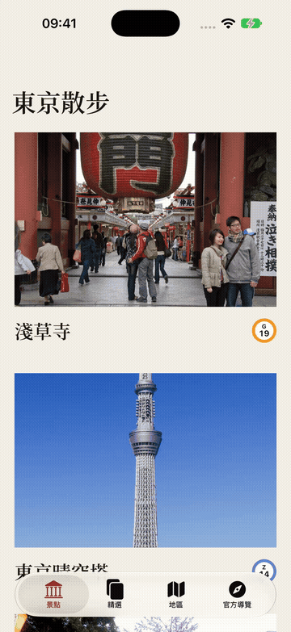
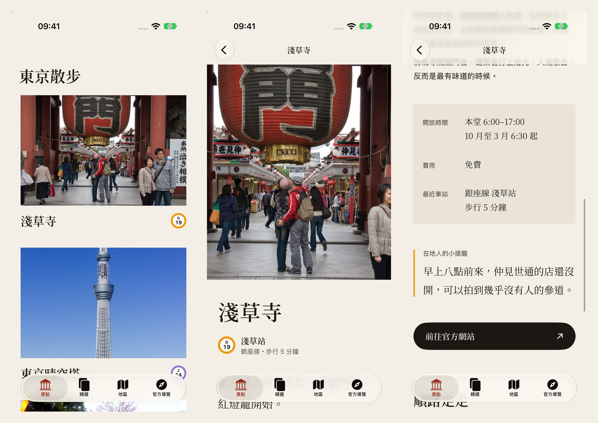
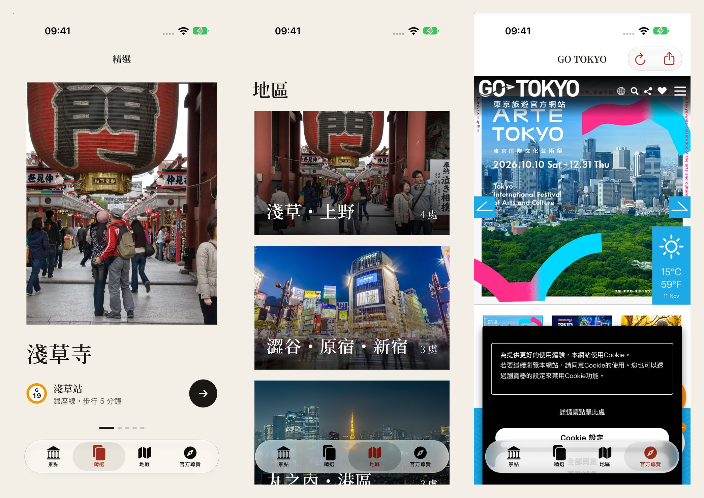
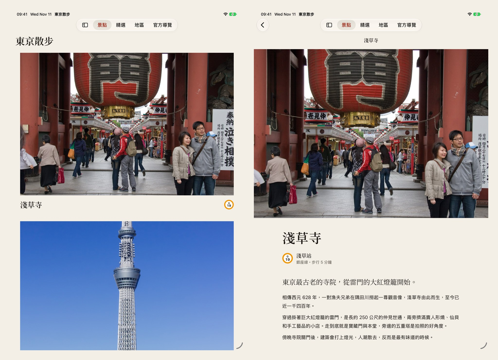
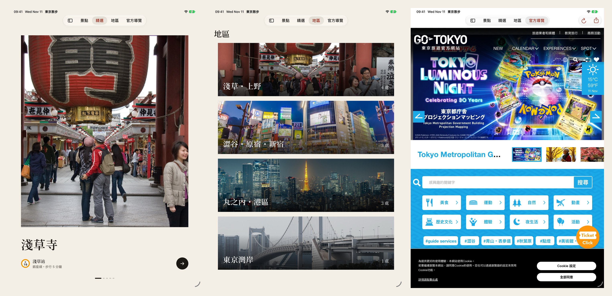
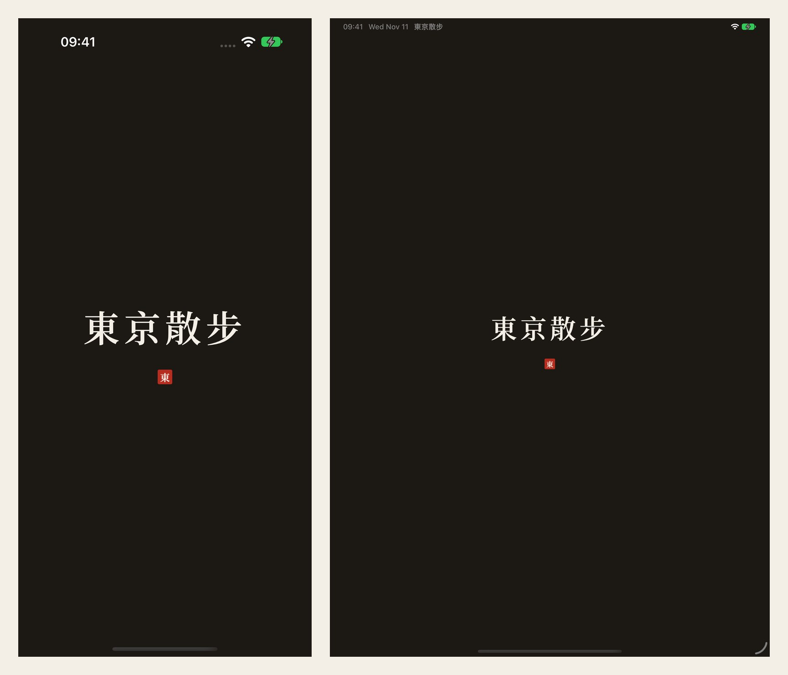

# #04 多頁面電子書 App｜東京散步：用地鐵站牌走一遍東京

GitHub 連結：https://github.com/cpcap1214/book_app


## 一、創作發想

這次的作業是做一個多頁面的電子書 App，我選的主題是東京的景點。

去東京玩的時候，我發現自己其實很少記得景點的地址，反而是記得「淺草站下車」、「銀座線」這種東西。東京的地鐵每一條線都有自己的顏色，每一站也都有站號，像淺草站就是橘色的 G19。所以我就想，乾脆把站牌當成每個景點的識別，打開 App 的時候先看到照片，旁邊放一個站牌，知道要坐哪條線過去。

App 裡總共有 11 個景點，分成 4 個地區：

- 淺草・上野：淺草寺、東京晴空塔、上野恩賜公園、秋葉原。
- 澀谷・原宿・新宿：澀谷十字路口、明治神宮、新宿御苑。
- 丸之內・港區：皇居二重橋、東京鐵塔、築地場外市場。
- 東京灣岸：台場與彩虹大橋。

## 二、App 畫面與操作

下面是實際在模擬器上操作的 demo，可以看到景點列表、點進介紹頁的轉場，還有精選和地區兩個分頁。



### iPhone

下面由左到右是景點列表、景點介紹的上半部，以及往下滑之後的資訊。


*景點列表、淺草寺介紹頁、開放時間與在地人的小提醒。*

App 下面有四個分頁：景點、精選、地區、官方導覽。


*精選可以左右滑，地區可以一層一層點進去，官方導覽則是直接顯示 GO TOKYO 的網站。*

### iPad

iPad 的畫面沒有另外寫一套，而是讓同一份畫面在大螢幕上自己調整。比較明顯的差別是 tab bar 會跑到上面，左邊也可以展開成側邊欄。列表和內文也限制了寬度，不然整排字拉滿 iPad 的螢幕，讀起來會很累。





### 開頭畫面

開頭畫面是墨黑色的底，中間放「東京散步」四個字，下面再加一個朱紅色的小印章。



## 三、作業要求怎麼做到的

### 1. 新增檔案定義頁面

每一個畫面都拆成獨立的檔案，像是 `SpotListView`、`SpotDetailView`、`FeaturedView`、`AreaViews` 和 `SpotWebView`。共用的顏色、字型和站牌元件則放在 `Theme.swift`，之後要改設計只要改一個地方。

### 2. 用 struct 整理景點資料

每個景點需要的資訊都放在 `Spot` 裡面，車站另外寫成 `Station`：

```swift
struct Station: Hashable {
    let name: String
    let line: String
    let code: String
    let lineColor: Color
    let walkMinutes: Int
}

struct Spot: Identifiable, Hashable {
    let id: String
    let name: String
    let imageName: String
    let areaID: String
    let station: Station
    let lead: String
    let paragraphs: [String]
    let hours: String
    let price: String
    let tip: String
    let website: URL
}
```

所有景點都放在 `TokyoData.spots` 這個 Array 裡，型別是 `[Spot]`。因為 `Spot` 遵從 `Identifiable`，`List` 和 `ForEach` 就可以直接用，不用另外指定 id。圖片在 Assets 裡的名字跟 `imageName` 一樣，所以新增景點的時候只要補一筆資料和一張照片，介紹頁就可以沿用。

### 3. TabView & Tab

最外層用 `TabView` 放四個分頁，再加上 `.sidebarAdaptable`，iPad 上的 tab bar 就會跑到上面，也可以變成側邊欄：

```swift
TabView(selection: $selection) {
    Tab("景點", systemImage: "building.columns", value: AppTab.spots) {
        SpotListView()
    }
    Tab("精選", systemImage: "rectangle.portrait.on.rectangle.portrait", value: AppTab.featured) {
        FeaturedView()
    }
    // 地區、官方導覽
}
.tabViewStyle(.sidebarAdaptable)
```

### 4. NavigationStack、NavigationLink 與 List

景點列表用 `List` 做，點下去之後用 `NavigationLink` 把整個 `Spot` 傳到下一頁，介紹頁再用 `.navigationTitle(spot.name)` 把景點名稱顯示在 navigation bar 上。

地區這個分頁則多了一層：地區 → 這個地區的景點 → 景點介紹，一樣都是用 `NavigationStack` 一路推進去。

這裡有一個小地方：`List` 裡面的 `NavigationLink` 預設會在右邊出現一個箭頭，跟大照片的版面放在一起有點奇怪。所以我把 `NavigationLink` 疊在卡片上面，再把它變成透明的：

```swift
ZStack {
    SpotCard(spot: spot, zoom: zoom)
    NavigationLink(value: spot) { EmptyView() }
        .opacity(0)
}
```

這樣點整張卡片還是可以換頁，但看不到箭頭。

### 5. 用 page 做水平滑動

精選的部分用 `TabView` 加上 `.tabViewStyle(.page)`，可以左右滑。原本的小圓點我拿掉了，改成自己畫的橫條，目前在哪一頁，那一條就會變長。

### 6. WebView 顯示網頁

從 iOS 26 開始，SwiftUI 可以直接用原生的 `WebView`。我搭配 `WebPage` 一起用，這樣可以知道網頁載入到哪裡，上面放一條進度條：

```swift
WebView(page)
    .overlay(alignment: .top) {
        if page.isLoading {
            ProgressView(value: page.estimatedProgress)
        }
    }
    .onAppear {
        page.load(URLRequest(url: url))
    }
```

官方導覽分頁顯示的是 GO TOKYO 的網站，每個景點介紹頁的最下面也有一個按鈕，可以打開那個景點的官網。

### 7. 開頭畫面

開頭畫面是在 Info.plist 的 `UILaunchScreen` 裡設定，背景顏色和中間的圖片都放在 Assets 裡：

```yaml
UILaunchScreen:
  UIColorName: LaunchBackground
  UIImageName: LaunchLogo
```

這邊有遇到一個問題：改完開頭畫面之後，iPad 模擬器還是一直顯示舊的紅色版本，App 刪掉重裝也一樣。後來發現是 iOS 會把開頭畫面快取起來，把 build 的版號加 1 之後才換成新的。

## 四、UI 與動畫

### 第一版太普通了

第一版做出來的時候，該有的東西其實都有了：照片、標題、站牌。但看起來就是很像一般的 App，沒什麼感覺。

後來整個重新設計，方向是日本的雜誌：

- 顏色只用三種：和紙的米色當背景、墨黑當文字、朱紅當點綴。
- 標題全部改成明體（Noto Serif TC），內文還是用系統字型。
- 照片放大、改成直角，不要圓角小縮圖。
- 資訊改成像雜誌一樣的表格，小提醒做成引言的樣子。

字型的部分，Noto Serif TC 整個檔案有 16 MB，直接放進 App 太大了。所以我寫了一個小程式，只把 App 裡面有用到的字留下來，最後每個字重大概只剩 400 KB。

### 動畫

動畫的部分我比較在意的是「不要一直晃」。所以會動的地方大多是換頁，或是第一次看到某個東西的時候，看完之後就停在原位。

**1. 點卡片放大成介紹頁**

這是用 iOS 18 的 zoom 轉場做的。列表上的照片當作起點，點下去之後照片會直接放大變成介紹頁：

```swift
Photo(name: spot.imageName, aspect: 3 / 2)
    .matchedTransitionSource(id: spot.id, in: zoom)

// 目的地
SpotDetailView(spot: spot)
    .navigationTransition(.zoom(sourceID: spot.id, in: zoom))
```

**2. 站牌的外圈會自己畫出來**

進到介紹頁的時候，站牌的路線色外圈會繞一圈畫出來，畫完之後站號才出現。外圈是用 `Circle().trim(from: 0, to: progress)` 做的，再把 `progress` 從 0 動畫到 1。

**3. 往下滑的時候，內容才浮上來**

介紹頁下面的資訊表、小提醒和按鈕，是捲到畫面上才淡入。這邊用的是 `onScrollVisibilityChange`，只要出現在畫面上就把狀態設成 `true`，而且只會播一次。

**4. 大圖的視差效果**

介紹頁最上面的大圖，往上滑的時候移動得比文字慢；往下拉的時候則會放大。做法是用 `GeometryReader` 讀出照片目前的位置，再依照位置改變 offset 和高度。

**5. 精選的照片會慢慢推近**

精選頁面停下來的時候，照片會非常慢地放大，大概 16 秒才放大到 1.08 倍，有一點像紀錄片的鏡頭。左右滑的時候，照片也會比頁面慢一點移動。

### 遇到的問題

一開始我想讓列表的卡片在滑進畫面時淡入，用的是 `scrollTransition`。結果在 `List` 裡面，卡片明明已經在畫面正中間，還是一直保持半透明又模糊的樣子，看起來像壞掉一樣。

查了之後發現 `scrollTransition` 在 `ScrollView` 裡比較準，放在 `List` 裡就不一定。最後改成用 `onAppear`：卡片第一次出現的時候，從模糊、略小的狀態淡入。效果差不多，但不會卡在一半。

## 五、照片來源

App 裡的景點照片都來自 Wikimedia Commons，依創用 CC 授權使用：

| 景點 | 照片 | 作者 | 授權 |
|---|---|---|---|
| 淺草寺 | Kaminarimon, Sensoji | KimonBerlin | CC BY-SA 2.0 |
| 東京晴空塔 | Tokyo Skytree 2014 Ⅲ | Kakidai | CC BY-SA 3.0 |
| 上野恩賜公園 | Uenocherryblossoms-nearkeiseiline-march20-2015 | Nesnad | CC BY-SA 3.0 |
| 秋葉原 | Akihabara streets | Raita Futo | CC BY 2.0 |
| 澀谷十字路口 | Tokyo Shibuya Scramble Crossing 2018-10-09 | Benh LIEU SONG | CC BY-SA 2.0 |
| 明治神宮 | Meiji Jingu, Tokyo; February 2011 (01) | TAKA@P.P.R.S | CC BY-SA 2.0 |
| 新宿御苑 | Wooden footbridge in Shinjuku Gyoen National Garden | Basile Morin | CC BY-SA 4.0 |
| 皇居二重橋 | Imperial Palace Tokyo Nijubashi Bridge | Chris 73 | CC BY-SA 3.0 |
| 東京鐵塔 | Tokyo Tower, Minato City | David Kernan | CC BY 4.0 |
| 築地場外市場 | Tsukiji Outer Market 2 | Aw1805 | CC BY-SA 3.0 |
| 台場與彩虹大橋 | Rainbow Bridge, Tokyo, South view from Odaiba | DXR | CC BY-SA 4.0 |

標題字型是 Noto Serif TC，採用 SIL Open Font License。

## 六、心得

這次做完覺得，作業要求的那幾個東西，像 `TabView`、`NavigationStack`、`List`，其實寫起來都不難，上課教過的就夠用了。

比較花時間的反而是畫面。第一版功能都有，但就是不好看；改了顏色、字型和照片的大小之後，才比較像我原本想像的樣子。

另外，動畫真的要放到模擬器裡實際滑一次才知道。像 `List` 裡面的卡片一直模糊，只看程式碼完全看不出來，是一邊用、一邊截圖，才發現哪裡怪怪的。
